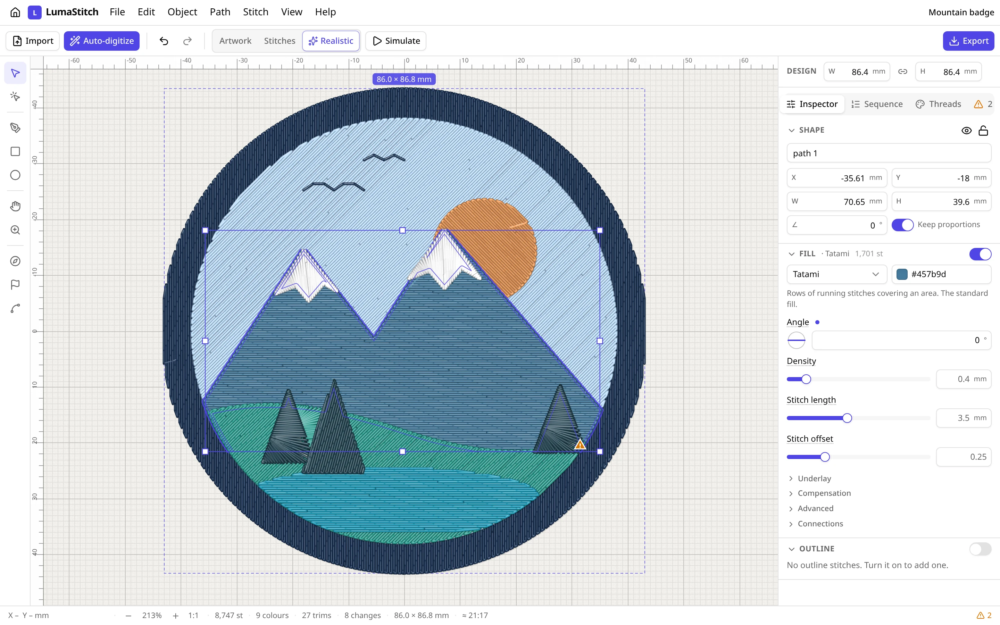
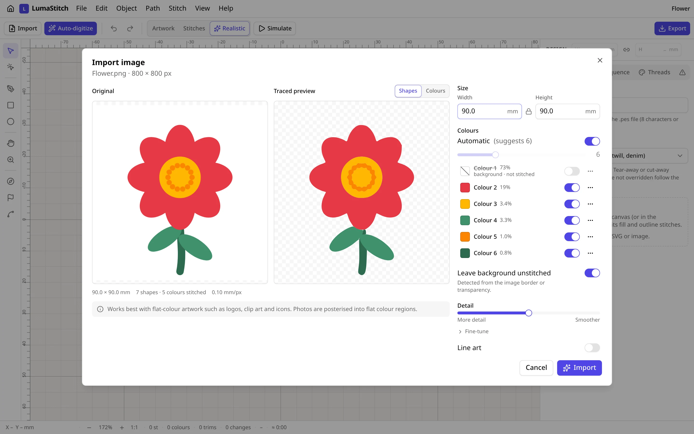
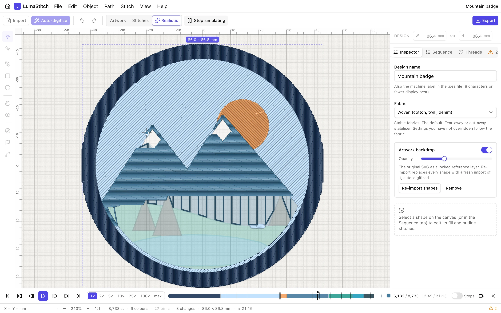
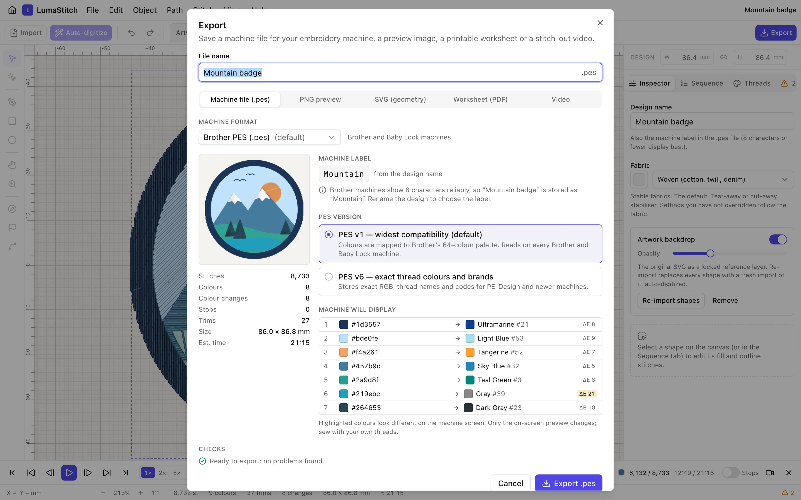
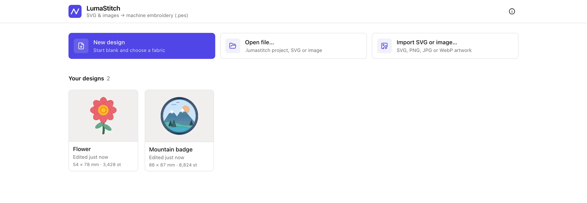

<div align="center">


# LumaStitch

**Turn SVGs and images into machine embroidery, right in your browser.**

Import artwork, auto-digitize it, fine-tune every stitch, watch the stitch-out, and export a `.pes` file for Brother and Baby Lock machines.

### [Open LumaStitch →](https://lumastitch.cretezy.com)

No account · No upload · Works offline · Free and open source (GPL-3.0)

<br>



</div>

## Features


- **Import SVG or images.** SVGs from Illustrator, Inkscape, Figma and friends keep their shapes, holes and transforms. PNG, JPG and WebP artwork is reduced to thread colours and traced into editable shapes.
- **Auto-digitize.** Every shape gets a sensible stitch type (tatami fill, satin columns, running stitch) and a thread colour, sewn in an optimised order with few trims.
- **Optimize stitch routes.** Exact small-route ordering, precedence-aware colour sequencing and an optional intersection router for running/bean networks. [Measured before/after and Ink/Stitch comparison](docs/routing/README.md).
- **Editable embroidery lettering.** Digitized satin rails, kerning, multiline and curved text, monograms and batch names with project/PES ZIP downloads. [Complete examples and GIFs](docs/lettering/README.md).
- **Edit like a vector app.** Select, move, scale, rotate and edit nodes; draw shapes; combine them with booleans; set stitch angle, density, underlay, compensation and start/end points per shape.
- **Many stitch types.** Tatami, satin, contour, meander, ripple, gradient and pattern fills, cross-stitch, appliqué, triple run, bean, motif and blanket stitches.
- **Complete stitch examples.** [Screenshots and MP4 comparison videos](docs/videos/README.md), plus [satin and tatami designs](docs/stitch-examples/README.md) with animated GIF stitch-outs, before/after comparisons, editable projects, SVG artwork and PES/DST downloads.
- **What you see is what gets sewn.** The canvas, the simulator and every export come from the same stitch plan, with realistic thread rendering.
- **Inspect stitch quality.** A worker-computed needle density map includes ties and underlay. Optional rectangular/elliptical sewing fields show fit warnings before machine export. [Calibration sampler](docs/inspection/README.md).
- **Simulator.** Play the stitch-out at machine speed or faster, step stitch by stitch, and jump between colours.
- **Export.** Brother PES (v1 and v6), DST, JEF, EXP and VP3, plus a PNG preview, SVG geometry, a printable PDF worksheet and an MP4/WebM stitch-out video.
- **Private by design.** Everything runs in your browser. Designs are saved in a local library (IndexedDB), never on a server, and can be backed up as `.lumastitch` files.

<br clear="right">

## Screenshots

<table>
  <tr>
    <td width="50%"><p align="center"><sub><b>Image import</b>: colours reduced to threads, background left unstitched</sub></p></td>
    <td width="50%"><p align="center"><sub><b>Simulator</b>: the stitch-out in sewing order, with a colour timeline</sub></p></td>
  </tr>
  <tr>
    <td width="50%"><p align="center"><sub><b>Export</b>: PES with the colours the machine will show, plus checks</sub></p></td>
    <td width="50%"><p align="center"><sub><b>Library</b>: designs saved automatically in your browser</sub></p></td>
  </tr>
</table>

## Editing and production workflows

### Lettering

Use **Object → Add lettering** for editable text, kerning, multiline/circular layouts, monograms and batch project/PES exports. The digitized catalog includes Geneva Simple Sans (118 glyphs), Geneva Simple Sans Rounded (120) and Chopin Script (116), with authored satin rails, running connectors and per-font size limits. [Digitized examples](docs/lettering/README.md) · [Rounded, script and monogram examples](docs/digitized-fonts/README.md).

OpenType lettering supports local TTF/OTF import, variable axes and four bundled Noto fonts: Sans, Serif, Sans Arabic and Sans Hebrew. Projects retain their fonts for portable editing. Unicode 17 bidirectional layout supports mixed Arabic/Hebrew, Latin and numbers. [OpenType examples](docs/opentype/README.md) · [Mixed-direction examples](docs/bidi/README.md).

Select an open curve and choose **Object → Add lettering on path**, then use **Object → Edit lettering baseline** to reshape the guide. Alignment, offset and direction remain editable. [Baseline editing and stitch-outs](docs/lettering-path/README.md).

### Editable machine files and stitch recognition

Open PES, DST, JEF, EXP and VP3 as editable needle/jump/trim/stop nodes. Moving and scaling changes the existing stitch program while preserving duplicate penetrations and short jumps. **Object → Recognize stitches…** previews inferred satin rails and simple tatami fills for geometry and density editing; unsupported needles and commands remain manual. [Import example](docs/machine-import/README.md) · [Recognition before/after](docs/recognition/README.md).

### Satin routing and splitting

Combine intersecting paths and enable **Advanced → Connect satin branches** to cover routing underpaths with the final satin pass. For compatible **Satin rails** objects, use **Object → Group satin rails for routing** to retain editable rails and guides. **Object → Split satin column** previews a centerline cut and creates two editable sections. [Connected fern](docs/satin-branches/README.md) · [Variable-width vine](docs/satin-rails/README.md) · [Split ribbon](docs/satin-split/README.md).

### Guided fills and appliqué

Select a closed fill shape and open guides, then **Object → Make guided fill**. Translated copies, parallel offsets and finite-guide buffers support holes, pull compensation and straight underlay. [Three complete guided-fill examples](docs/guided-fill/README.md).

Appliqué supports pre-cut fabric, hidden-cover removal and manual edge omission, while preserving placement/tack-down. Open **Appliqué border** outlines sew the phases along drawn curves. **File → Appliqué cutting export** produces numbered SVG/DXF pieces with holes, allowance, mirroring and a reference layout. [Cutting packages](docs/applique/README.md) · [Edge controls and open borders](docs/applique-edges/README.md).

### Fabric calibration and inspection

Design settings saves custom spacing, compensation and underlay defaults with fabric/needle/thread/stabilizer notes. Profiles stay embedded in projects and can be reused locally or shared as JSON; per-object overrides remain in effect. The needle-density map and optional sewing-field checks help inspect the generated plan. [Portable profile](docs/fabric/README.md) · [Calibration sampler and inspection screenshots](docs/inspection/README.md).

### Multi-hooping

**File → Multi-hooping export** creates numbered machine/project ZIPs with shared registration marks, basting frames, placement SVGs and manifests. Edit field centers and rotation or search field angles automatically. The whole-object option keeps fitting shapes and touching layer groups in one field, preserving source sewing order; oversized groups retain their seams. All five output formats receive decoded field-fit checks. [Registered fields](docs/hooping/README.md) · [Rotated placements](docs/hooping-placements/README.md) · [Whole objects](docs/hooping-objects/README.md) · [Touching layers](docs/hooping-layers/README.md).

## Supported formats

| Direction | Formats                                                                                             |
| --------- | --------------------------------------------------------------------------------------------------- |
| Import    | SVG, PNG, JPG, WebP, `.lumastitch` projects; PES, DST, JEF, EXP and VP3 as editable stitch programs |
| Machine   | Brother/Baby Lock PES (v1, v6), Tajima DST, Janome JEF, Melco EXP, Pfaff/Husqvarna Viking VP3       |
| Other     | PNG preview, SVG geometry, PDF production worksheet, MP4/WebM stitch-out video                      |

The PES, DST, JEF, EXP and VP3 writers are byte-for-byte ports of [pyembroidery](https://github.com/EmbroidePy/pyembroidery), checked against it in the test suite. Results of sewing on a real machine (Brother SE600) are recorded in [docs/sew-tests.md](./docs/sew-tests.md).

## Documentation

- [Example gallery](docs/videos/README.md): screenshots, stitch-out GIFs, comparison MP4s and downloadable projects
- [Capability acceptance ledger](docs/capabilities.md): comparison targets, evidence and outstanding work
- [SPEC.md](./SPEC.md): what LumaStitch does and why
- [ARCHITECTURE.md](./ARCHITECTURE.md): how it is built
- [LICENSE](./LICENSE) (GPL-3.0-or-later) and [NOTICE.md](./NOTICE.md) (third-party code and data)

## Development

Requires Node 22.12 or newer.

```bash
npm install
npm run dev          # Vite dev server
npm test             # unit tests (Node) + browser tests (Chromium via Playwright)
npm run e2e          # end-to-end tests against a production build
npm run build        # type-check + production build into dist/
```

Browser tests need Playwright's Chromium once: `npx playwright install chromium`.

The screenshots above are generated from a production build with `node scripts/readme-screenshots.mjs` (needs `cwebp`, `img2webp` and `ffmpeg`).

### Project layout

| Path                      | What                                                                                                           |
| ------------------------- | -------------------------------------------------------------------------------------------------------------- |
| `src/model`               | Document types, factories, invariants, zod schema and migrations                                               |
| `src/store`               | Zustand stores (document with undo, UI, plan), commands and app actions                                        |
| `src/geom`                | Geometry kernel: flattening, Clipper2 wrapper, scanlines, medial axis, Paper.js adapter                        |
| `src/engine`              | Pure stitch engine (runs in a Web Worker): stitch types, sequencer, auto-digitize analysis, sequence optimiser |
| `src/raster`              | Image digitizer (quantise, clean, trace with Potrace) in its own worker                                        |
| `src/io`                  | SVG import, PES writer/reader, other machine formats, project files, exports                                   |
| `src/threads`             | Colour maths (CIELAB, ΔE2000), thread charts, k-means                                                          |
| `src/canvas`, `src/tools` | Canvas layers, stitch renderer, editing tools                                                                  |
| `src/simulator`           | Stitch-out playback                                                                                            |
| `src/components`          | React UI (shadcn/ui + Radix)                                                                                   |
| `tests/`                  | Fixtures (SVG, PES goldens), integration tests, pyembroidery tools                                             |

## Deployment

The app is static files served by Cloudflare Workers static assets (see `wrangler.jsonc`; there is no Worker script). Cloudflare Workers Builds deploys every push to `main`; `npm run deploy` builds and deploys by hand.

Non-production branches use `npx wrangler preview`; the empty `previews` block inherits the static asset configuration for branch previews.

`public/_headers` sets long-lived caching for hashed assets and a strict Content-Security-Policy. `npx wrangler dev` serves `dist/` the way production does.

## Licence

LumaStitch is free software under the [GNU General Public License v3.0 or later](./LICENSE). It builds on pyembroidery, Ink/Stitch's thread palettes, Potrace, Paper.js, Clipper2 and others; see [NOTICE.md](./NOTICE.md).
