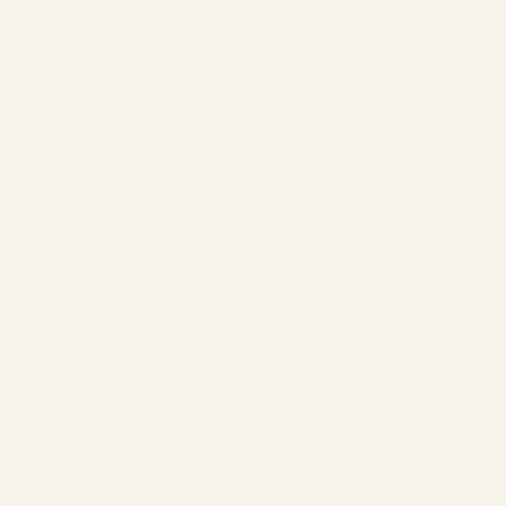
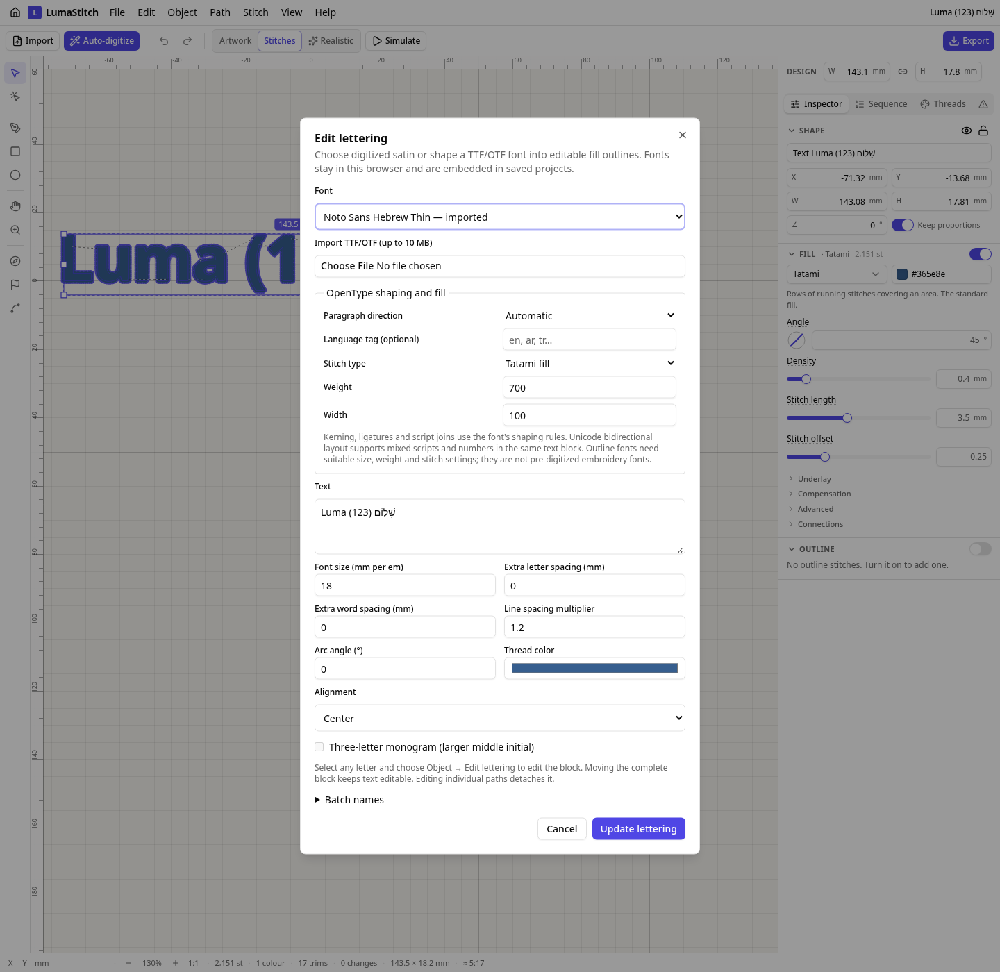

# Mixed-direction lettering

Latin text, Arabic or Hebrew and numbers now share a single editable text block. Before this change, mixing RTL scripts with Latin/numbers produced an error. The following are complete new examples, not fabricated renderings of that unsupported behavior.

**Paragraph direction** chooses the base direction. Embedded words and digits retain their Unicode-resolved reading order. The two Arabic examples use identical logical text, `Luma سَلَام 123`, with different paragraph bases; numbers are never manually reversed. Contextual Arabic joins, Hebrew vowel marks and paired brackets are shaped by HarfBuzz. The curved example uses the same mixed text on an editable Bézier baseline.

| Example | Needles | Trims | Jump distance |
| --- | ---: | ---: | ---: |
| Arabic + Latin, LTR paragraph | 1,829 | 16 | 102.11 mm |
| Arabic + Latin, RTL paragraph | 1,822 | 15 | 122.75 mm |
| Hebrew + Latin + numbers | 2,151 | 17 | 110.89 mm |
| Mixed text on a curve | 1,828 | 13 | 123.13 mm |

| LTR paragraph | RTL paragraph |
| --- | --- |
|  |  |
| [Project](arabic-ltr/arabic-ltr.lumastitch) · [SVG](arabic-ltr/arabic-ltr.svg) · [PES](arabic-ltr/arabic-ltr.pes) · [DST](arabic-ltr/arabic-ltr.dst) | [Project](arabic-rtl/arabic-rtl.lumastitch) · [SVG](arabic-rtl/arabic-rtl.svg) · [PES](arabic-rtl/arabic-rtl.pes) · [DST](arabic-rtl/arabic-rtl.dst) |

| Hebrew with marks and brackets | Continuous curved outlines |
| --- | --- |
|  |  |
| [Project](hebrew/hebrew.lumastitch) · [SVG](hebrew/hebrew.svg) · [PES](hebrew/hebrew.pes) · [DST](hebrew/hebrew.dst) | [Project](mixed-curve/mixed-curve.lumastitch) · [SVG](mixed-curve/mixed-curve.svg) · [PES](mixed-curve/mixed-curve.pes) · [DST](mixed-curve/mixed-curve.dst) |



Choose **Object → Add lettering**, select **Noto Sans Arabic** or the newly bundled **Noto Sans Hebrew**, enter mixed text and choose the paragraph direction. Font files and licenses remain embedded in projects. The same shaping works in batch-name projects and after reopening. All four examples use an 18 mm em size and weight 700; font size is not cap height. These examples exceed a 100 mm sewing width and require an appropriate field or multi-hooping.

Validation:

- **91,707** official Unicode 17 character cases and **770,241** class/direction cases pass. A deterministic 481-case sample runs in the ordinary test suite.
- Native **FriBidi 1.0.17 + uharfbuzz 0.56.3 / HarfBuzz 14.6.0** independently reproduce glyph IDs, source clusters, mark offsets, positions and line advances for all four examples.
- Supplementary-plane RTL scripts are indexed as Unicode scalars, then mapped to the original UTF-16 offsets expected by HarfBuzz. Tests cover mixed runs, controls, numbers, script marks and trailing whitespace.
- Committed examples reproduce their PES programs byte-for-byte. Browser tests cover paragraph-direction changes, font selection, mixed-script batch export, undo and reload.

The bidi engine is derived from MIT-licensed `bidi-js` 1.1.0 with updated Unicode 17 data, scalar indexing and a local-line whitespace fix. Licenses and modifications are recorded in [NOTICE](../../NOTICE.md). [HarfBuzz's text-run requirements](https://harfbuzz.github.io/text-runs.html) explain why bidi resolution and script itemization precede shaping; the [Unicode 17 data and tests](https://www.unicode.org/Public/17.0.0/ucd/) provide the reference behavior.

The text block still uses one font; it must cover every requested script. There is no automatic font fallback, automatic line wrapping or vertical text layout. Newlines create separate paragraphs. Connected RTL text requires zero extra letter spacing. Software conformance and the GIFs do not establish physical sew quality for small stems, joins or marks.

Reproduce the visual examples:

```sh
EXAMPLES_MODULE=/tests/bidi/examples.ts node scripts/stitch-examples.mjs . docs/bidi
python tests/tools/check_bidi_shaping.py  # native FriBidi and uharfbuzz==0.56.3
npm run build
node scripts/bidi-screenshot.mjs
```

For full conformance, download Unicode 17's `BidiCharacterTest.txt` and `BidiTest.txt` into a directory, then run `node tests/tools/check_bidi.mjs <directory>`. To regenerate the property tables, also provide `extracted/DerivedBidiClass.txt`, `BidiBrackets.txt`, `BidiMirroring.txt`, `Scripts.txt`, `ScriptExtensions.txt` and `PropertyValueAliases.txt`, then run `python scripts/generate-lettering-unicode.py <directory>`.
