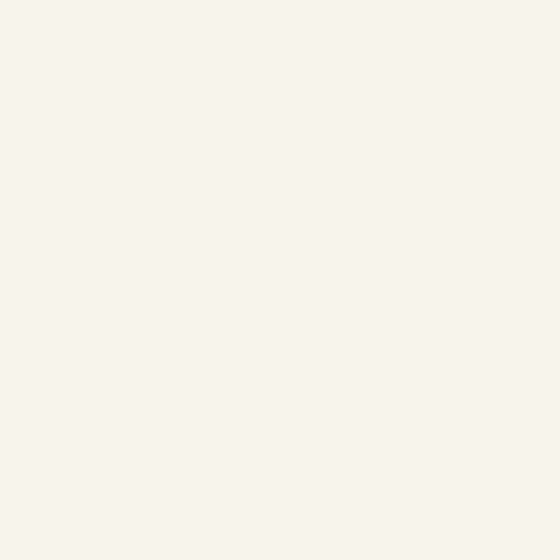

# Digitized lettering styles

**Object → Add/Edit lettering** now offers three fonts with authored satin rails and running connectors, alongside the four bundled outline fonts and TTF/OTF import. The font selector shows each digitized font's supported size range and source/license link. Font choice, text, kerning, spacing, multiline/arc/path layout and monograms remain editable in saved projects. Missing characters produce an explicit error.

| Digitized font | Glyphs | Supported nominal capital height | License |
| --- | ---: | --- | --- |
| Geneva Simple Sans | 118 | 10–20 mm | CC-BY-SA 2.5 + Hershey notices |
| Geneva Simple Sans Rounded | 120 | 10.5–21 mm | CC-BY-SA 2.5 + Hershey notices |
| Chopin Script | 116 | 30.64–45.96 mm | CC-BY-SA 4.0; source original-font notice retained |

Ranges follow the pinned font metadata's nominal size and scale limits. Glyph swashes and overshoots can extend outside the nominal capital-height guides; check the generated design bounds. The smaller monogram initials are 75% of the middle initial, and the UI raises the size enough to keep all three within their font's supported range. These are supported software ranges, not physical sew-out certification.

The new styles add **236 digitized glyphs**. This is a curated three-font catalog, not parity with every commercial font library. All source SVGs, metadata, extracted paths and license notices are included under `src/lettering/fonts`. Every glyph in both new fonts generates without errors at both size limits. The three previously committed Geneva Simple examples still reproduce their PES files exactly.

## Complete examples

| Example | Needles | Trims | Jump distance | Generated bounds |
| --- | ---: | ---: | ---: | --- |
| Rounded “LumaStitch”, 12 mm | 1,485 | 19 | 139.10 mm | 95.60 × 12.99 mm |
| Chopin “Luma”, 34 mm | 2,028 | 15 | 124.49 mm | 86.85 × 29.91 mm |
| Chopin “ABC” monogram, 44 mm | 4,703 | 17 | 236.32 mm | 126.84 × 43.13 mm |

The monogram exceeds a 100 mm sewing field. Choose a suitable larger field or review a multi-hooping package. These examples retain font-authored part order and use LumaStitch's own stitch generation; they are not byte-equivalent Ink/Stitch outputs or claims of improved routing.

| Rounded satin | Script satin | Script monogram |
| --- | --- | --- |
|  |  |  |

| Example | Editable project | Artwork | Machine outputs | Preview |
| --- | --- | --- | --- | --- |
| Rounded | [Project](rounded/rounded.lumastitch) | [SVG](rounded/rounded.svg) | [PES](rounded/rounded.pes), [DST](rounded/rounded.dst) | [PNG](rounded/preview.png) |
| Script | [Project](script/script.lumastitch) | [SVG](script/script.svg) | [PES](script/script.pes), [DST](script/script.dst) | [PNG](script/preview.png) |
| Monogram | [Project](script-monogram/script-monogram.lumastitch) | [SVG](script-monogram/script-monogram.svg) | [PES](script-monogram/script-monogram.pes), [DST](script-monogram/script-monogram.dst) | [PNG](script-monogram/preview.png) |


Batch ZIPs include the selected digitized fonts' source notices in `licenses/<font>.txt`, with attribution and pinned source links. Source licenses continue to apply to the font geometry; see the notices for their terms.

## Source and reproduction

Fonts are pinned to Ink/Stitch embroidery-fonts commit `084eac038bf1af5a3a8b881a6cf0cc3340cf6e9b`: [Geneva Rounded](https://github.com/inkstitch/embroidery-fonts/tree/084eac038bf1af5a3a8b881a6cf0cc3340cf6e9b/src/geneva_rounded), [Chopin Script](https://github.com/inkstitch/embroidery-fonts/tree/084eac038bf1af5a3a8b881a6cf0cc3340cf6e9b/src/chopin). Chopin was adapted by Célia Imbert Sabater from Claude Pelletier's original. Geneva derives from the Hershey fonts; its complete source notice includes the required acknowledgements and citation.

The extractor retains path geometry/transforms and maps dashed paths to running stitches, even when a stale satin flag is present. Font-specific running lengths are retained. The original Geneva Simple extraction rules remain pinned for saved-output compatibility. All three extracted datasets reproduce exactly with the script’s `--check` option. Existing rail normalization identifies and orients rails/rungs. Layout/cache keys, size limits, metadata and licensing are per font; no new generation algorithm is substituted for these digitized rails.

```sh
python scripts/extract-lettering-font.py --check
python scripts/extract-lettering-font.py geneva-rounded
python scripts/extract-lettering-font.py chopin
npx prettier --write src/lettering/fonts/geneva-rounded/*.json src/lettering/fonts/chopin/*.json
EXAMPLES_MODULE=/tests/digitized-fonts/examples.ts node scripts/stitch-examples.mjs . docs/digitized-fonts
npm run build
node scripts/digitized-fonts-screenshot.mjs
```

Tests cover every new glyph at both range limits, per-font caches, size/monogram errors, missing glyphs, project font IDs, batch licenses, exact example PES reproduction, font changes, undo, fractional size submission and reload. GIFs render actual generated stitches; physical sew results remain unverified.
