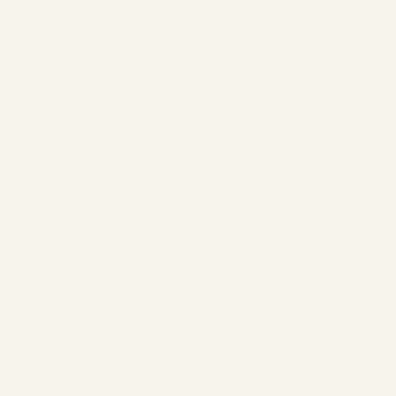

# Reusable fabric calibration profiles



Open [the example project](fabric-profile/fabric-profile.lumastitch) and **File → Design settings → Custom fabric profiles**. The example uses inherited 0.5 mm tatami spacing, 0.45 mm satin spacing and 0.2 mm compensation on a 30 mm square and 3/6 mm satin columns. It is explicitly marked **unsewn**: these are example values, not measured fabric recommendations.

Adjust fill/satin spacing, compensation, fill/satin underlay and fill-underlay spacing. Record stabilizer, needle, thread and sew-out notes. **Save and apply profile** saves a reusable browser-library copy and applies a snapshot to the current project in one undo step. New shapes inherit it; explicit object overrides remain authoritative. Changing the starter fabric removes the custom profile. Deleting a library copy does not change projects that already embed it.

[Download example profile JSON](example-profile.json) to import in another browser. A profile JSON file holds up to 100 named profiles; importing an existing name replaces that library entry. Projects independently embed the active profile, so they reproduce without the local library. The worksheet shows its name and stabilizer. Notes and full metadata remain in the project/JSON.

The example folder also has SVG artwork, PES, DST and PNG. For physical calibration, sew the [spacing comparison sampler](../inspection/README.md), record measurements and results, then save the settings that worked for that combination of fabric, thread, needle, stabilizer and machine. The software does not infer successful sew quality from a render.

Reproduce:

```sh
EXAMPLES_MODULE=/tests/fabric/examples.ts node scripts/stitch-examples.mjs . docs/fabric
```
