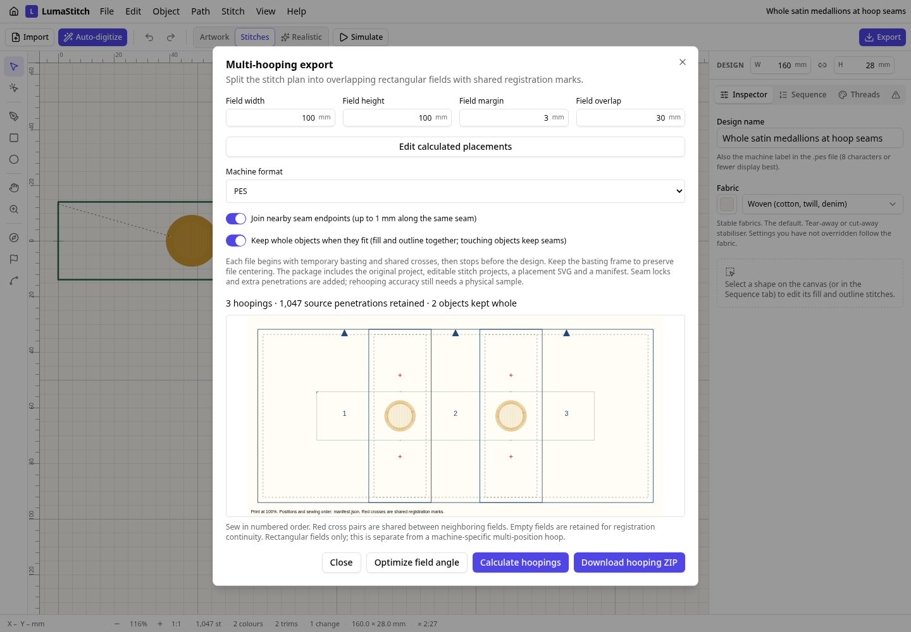

# Keeping whole objects across hoop seams

Two medallions sit on the ownership seams of a three-field layout. With **Keep whole objects when they fit**, each medallion's tatami center and satin outline move together into one field. The long running border still crosses all three fields. The original source vectors remain in the source project.

| Measured output | Before | After |
| --- | ---: | ---: |
| Hoopings | 3 | 3 |
| Source penetrations retained | 1,047 | 1,047 |
| Total needles including registration and locks | 1,584 | 1,512 |
| Trims | 47 | 35 |
| Medallions kept whole | 0 | 2 |

[Original project](source-panel/source-panel.lumastitch) · [SVG](source-panel/source-panel.svg) · [PES](source-panel/source-panel.pes) · [DST](source-panel/source-panel.dst) · [source GIF](source-panel/stitch-out.gif)

| Before: first hoop splits a medallion | After: first hoop keeps its medallion whole |
| --- | --- |
|  |  |
| [Project](before-hoop-1/before-hoop-1.lumastitch) · [PES](before-hoop-1/before-hoop-1.pes) · [DST](before-hoop-1/before-hoop-1.dst) | [Project](after-hoop-1/after-hoop-1.lumastitch) · [PES](after-hoop-1/after-hoop-1.pes) · [DST](after-hoop-1/after-hoop-1.dst) |

Full three-hoop packages: [before ZIP](before.zip) · [after ZIP](after.zip). Both contain numbered machine files, editable stitch projects, source vectors, placement SVG, manifest and instructions. All six before/after hoop directories include SVG, PNG, GIF, project, PES and DST outputs. [Second hoop before](before-hoop-2/stitch-out.gif) / [after](after-hoop-2/stitch-out.gif); [third hoop before](before-hoop-3/stitch-out.gif) / [after](after-hoop-3/stitch-out.gif).



Open the source, choose **File → Multi-hooping export**, enable **Keep whole objects when they fit**, and calculate. The result reports two objects kept whole. The manifest records their original IDs and both stitch-element IDs. Undo restores the previous policy; saved projects preserve it.

This policy is deliberately conservative about layers. A whole object assigned to an earlier hoop could otherwise be over-sewn by another hoop's later background. Any source shape whose sewn chord bounds touch another shape within a 0.5 mm exclusion band keeps its existing seam assignment. An overlapping-background regression verifies unchanged output in that case. Long or diagonal chord bounding boxes can reject some safe moves. The feature does not solve general packing of overlapping layered objects, and machine projects remain stitch programs rather than recovered vectors.

Tests cover fill/outline grouping, incoming connectors, all source needles after rotation, project persistence, overlapping-layer fallback and decoded fit in all five formats. All six committed PES programs are reproduced byte-for-byte from the source fixture. The GIFs show actual engine output; physical sew quality and registration are unverified.

Reproduce:

```sh
EXAMPLES_MODULE=/tests/hooping-objects/examples.ts node scripts/stitch-examples.mjs . docs/hooping-objects
node scripts/hooping-objects-package.mjs
npm run build
node scripts/hooping-objects-screenshot.mjs
```
