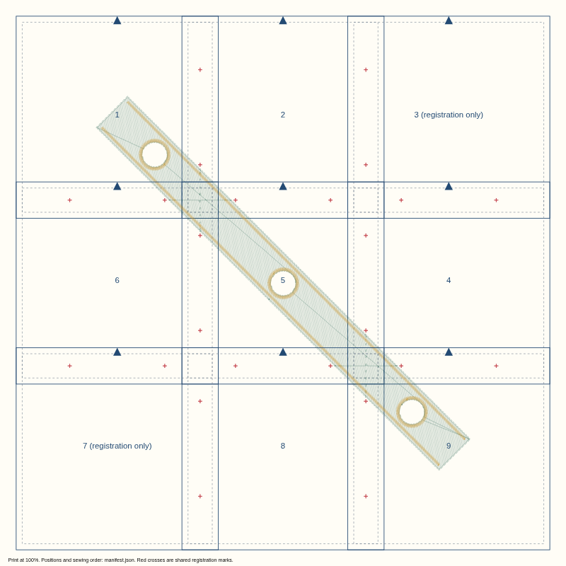
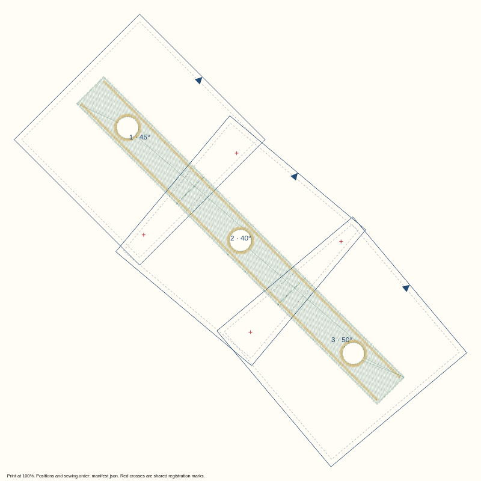
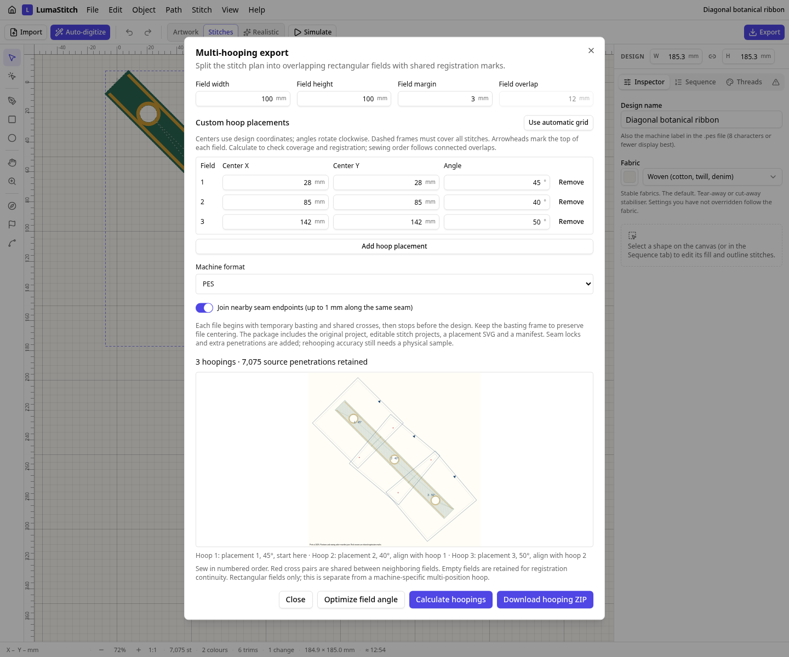

# Editable rotated hoop placements

The 240 mm diagonal botanical ribbon contains tatami, three cutouts, satin rings and satin edges. The original rectangular grid needs **nine fields**. Three manually positioned fields at **45°, 40° and 50°** cover the same needle program. The automatic 5° angle search also finds a three-field regular rotated grid; it is a bounded heuristic, not a global arbitrary-placement optimum.

| Measured export | Automatic unrotated grid | Edited rotated fields |
| --- | ---: | ---: |
| Hoopings | 9 | 3 |
| Source penetrations retained | 7,075 | 7,075 |
| Total needles, including basting, registration and locks | 9,096 | 7,836 |
| Trims | 183 | 83 |
| Registration stops | 9 | 3 |

The reduction comes from fewer frames, fewer registration stitches and fewer seams. Both layouts retain source-stage order within each hoop. This example is not a sew-out or a claim that arbitrary designs always improve by this amount.

| Before | After |
| --- | --- |
|  |  |
| [Grid package](before.zip) · [actual-size SVG](before-layout.svg) · [manifest](before-manifest.json) | [Rotated package](after.zip) · [actual-size SVG](after-layout.svg) · [manifest](after-manifest.json) |

Open the [source project](source-ribbon/source-ribbon.lumastitch), then **File → Multi-hooping export**. Calculate a grid and choose **Edit calculated placements**, or choose **Optimize field angle**. Change each center and angle, add/remove fields, then calculate again. The immediate artwork preview remains available for invalid drafts; successful calculation checks the complete needle program and saves an undoable layout. Download is disabled after edits until calculation succeeds.



| Source | Hoop 1 | Hoop 2 | Hoop 3 |
| --- | --- | --- | --- |
|  |  |  |  |
| [Project](source-ribbon/source-ribbon.lumastitch) · [SVG](source-ribbon/source-ribbon.svg) · [PES](source-ribbon/source-ribbon.pes) · [DST](source-ribbon/source-ribbon.dst) | [Project](hoop-01/hoop-01.lumastitch) · [SVG](hoop-01/hoop-01.svg) · [PES](hoop-01/hoop-01.pes) · [DST](hoop-01/hoop-01.dst) | [Project](hoop-02/hoop-02.lumastitch) · [SVG](hoop-02/hoop-02.svg) · [PES](hoop-02/hoop-02.pes) · [DST](hoop-02/hoop-02.dst) | [Project](hoop-03/hoop-03.lumastitch) · [SVG](hoop-03/hoop-03.svg) · [PES](hoop-03/hoop-03.pes) · [DST](hoop-03/hoop-03.dst) |

Each program begins with basting and shared registration crosses, then stops. The marks shown in red in the template are temporary; keep the frame in the machine file to preserve centering. The custom manifest explicitly identifies an earlier registration parent. Sewing order can differ from the placement editing list. Arrowheads indicate the top of each field; rotate the fabric placement as shown rather than rotating the exported machine program again.

Coverage uses the nearest field center among fields that actually contain the stitch. Chords are checked throughout, including gaps between covered endpoints. Overlaps must hold a pair of crosses at least 5 mm apart with clearance for either rotation. Limits are 64 fields, 500,000 source commands and 30 million geometry comparison units. Fields share dimensions; individual hoop sizes, original-object preservation across seams and machine-specific multi-position hoop formats remain separate work.

All five formats pass decoded field-fit and source-position tests. The independent `pyembroidery==1.5.1` check decodes both committed PES packages and reconstructs original coordinates: every one of the 7,075 source needles is within **0.06985 mm** after rotation, below the 0.07071 mm maximum from rounding local coordinates to 0.1 mm. Source coordinates are first quantized to the same 0.1 mm input grid as the existing splitter. The independent check establishes file geometry, not physical fabric registration.

Reproduce:

```sh
EXAMPLES_MODULE=/tests/hooping-placements/examples.ts node scripts/stitch-examples.mjs . docs/hooping-placements
node scripts/hooping-placements-package.mjs
python tests/tools/check_hooping_placements.py  # requires pyembroidery==1.5.1
npm run build
node scripts/hooping-placements-screenshot.mjs
```

Comparator context: Hatch documents [rotating hoops](https://hatch.embroideryhelp.net/v3/en/OnlineHelp/Hooping/hooping/Rotate_hoops.htm) and [positioning multiple hoops](https://hatch.embroideryhelp.net/v4/en/OnlineHelp/Hooping/hooping/Hooping_concepts.htm). This implementation was written independently; no competitor code or output is embedded here. Fabric, stabilizer and machine registration remain unverified until actual sew-outs are recorded.
