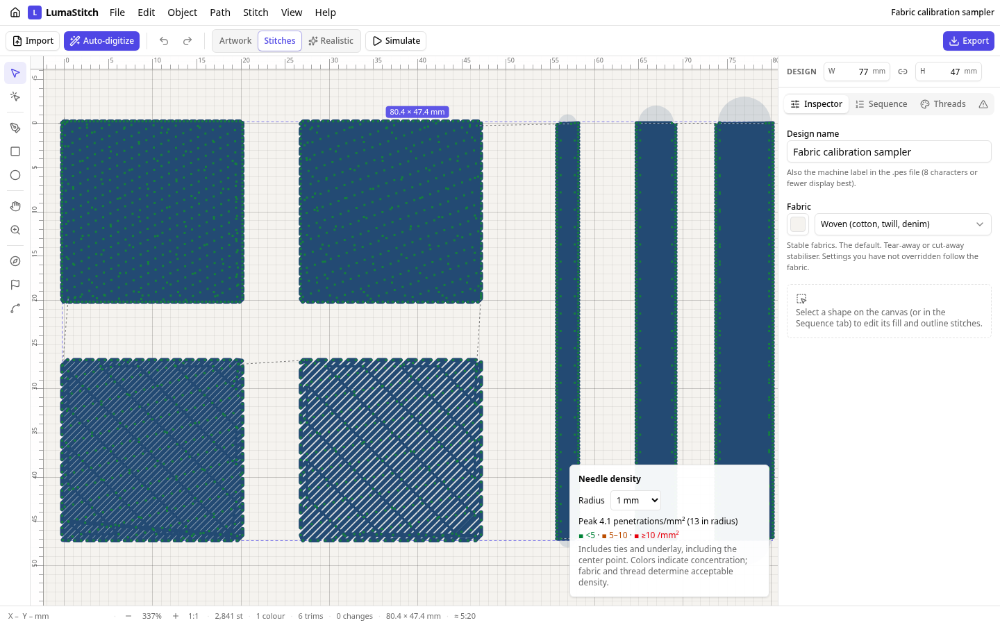
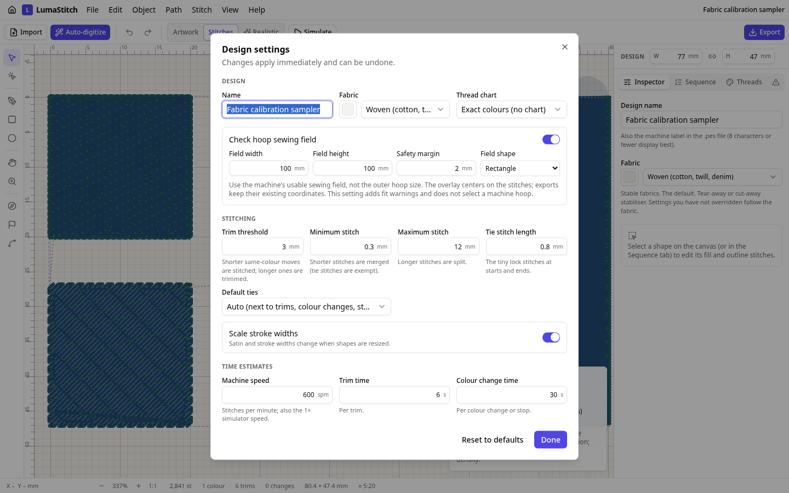

# Density inspection and fabric calibration

Use View → Needle density map to inspect penetration concentration, including ties and underlay. Choose a 0.5, 1, 2 or 3 mm circular radius. Fixed bins are below 5, 5–10 and at least 10 penetrations/mm²; the legend reports the exact peak. The bins are not universal fabric safety thresholds.

Design settings → Check hoop sewing field enables a rectangular/elliptical usable field and margin. Use the machine's embroidery area, not the outer hoop dimensions. A red overlay and machine-export warning identify a fit failure. The setting does not alter the exported coordinates or command a hoop change.

## Complete calibration sampler

[Editable project](fabric-calibration/fabric-calibration.lumastitch) · [SVG](fabric-calibration/fabric-calibration.svg) · [PES](fabric-calibration/fabric-calibration.pes) · [DST](fabric-calibration/fabric-calibration.dst) · [Measured output](metrics.json)

The four 20 mm tatami squares use spacing 0.3 and 0.4 mm on the top row, 0.5 and 0.6 mm on the bottom row. The three satin columns, left to right, are 2, 4 and 6 mm wide at 0.4 mm spacing. The project uses a 100 × 100 mm sewing field with 2 mm margin.

For each fabric/stabilizer/thread/needle combination, sew a separate sampler and record machine model, tension, speed, stabilizer, thread weight, needle size, finished square dimensions, finished satin widths, coverage, puckering and thread breaks. Keep a photo with the record. Compare target versus finished widths before adjusting pull compensation; change one parameter at a time. Save the adjusted project alongside the record.

This sampler is software-validated and has **not** been physically sewn in this session. Record actual results in [sew-tests.md](../sew-tests.md). Custom reusable fabric profiles and automatic calibration fitting remain outstanding.

Reproduce with `EXAMPLES_MODULE=/tests/inspection/examples.ts node scripts/stitch-examples.mjs . docs/inspection`.
