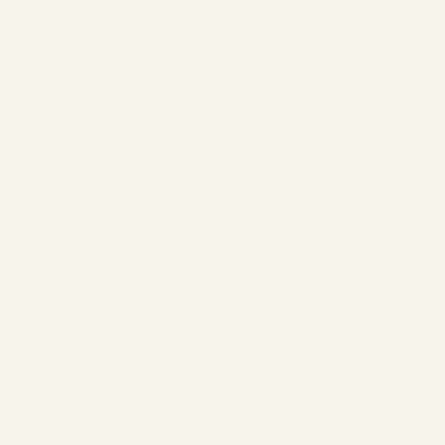

# Lettering along an editable path

[Curved project](curve/curve.lumastitch) · [Straight comparison](straight/straight.lumastitch) · [Baseline editor](baseline-editor.png)

Select one open vector curve and choose **Object → Add lettering on path**. The source curve becomes the text block's dashed, non-sewing baseline. Set the text, capital height, alignment, normal offset or reversed direction. Letters remain rigid digitized glyphs and rotate to follow the local path tangent. Text must fit the available path at the font's supported size; it is not silently compressed.

| Straight baseline | Bézier baseline |
| --- | --- |
|  |  |

Both folders include the editable project, SVG, PES, DST, PNG and GIF. The same text/font/height yields 1,528 needles on the straight baseline and 1,522 on the curve; transformed endpoints affect ties and short connections. This is a layout example, not a routing benchmark or physical sew test.

Select the lettering and choose **Object → Edit lettering baseline**, then drag its nodes or handles. On commit, the letters reposition in the same undo step. Invalid edits that make the path too short are rejected with a fit message. Normal movement/scaling of the complete block (including the guide) retains editable text and its transform. Per-letter stitch settings survive baseline reflow; custom position-dependent entry/exit/direction hints are cleared. Direct letter geometry edits detach the text block as before.

Baseline paths are saved in local coordinates with a linked guide, support at most 2,000 vector nodes, and flatten at 0.03 mm. Open paths only; use the existing arc option for circular text. A baseline uses one line and cannot also use the arc option. Batch projects retain the baseline link and contain no guide stitches. Tests cover alignment, normal offset, reversed direction, source replacement, short-path rejection, stable IDs, full-block transforms, project persistence, browser node dragging and undo/redo.

```sh
EXAMPLES_MODULE=/tests/lettering-path/examples.ts node scripts/stitch-examples.mjs . docs/lettering-path
node scripts/lettering-path-screenshot.mjs
```
