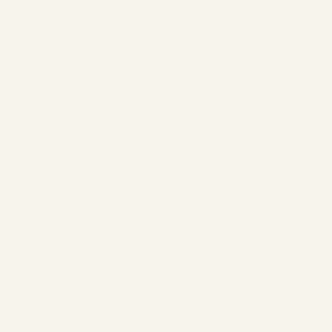

# Editable embroidery lettering

Object → Add lettering creates digitized satin text. Select any member and use Object → Edit lettering to change the entire block. Whole-block transforms preserve editable text; moving only part of the block or editing nodes detaches the text and leaves ordinary editable paths. Undo restores either operation.

The bundled Geneva Simple Sans font has 118 glyphs, kerning and a supported capital height of 10–20 mm. Unsupported characters are reported. Monograms use three initials in entered order, with the outer initials at 75% of the middle height (minimum middle height 13.34 mm). Curved lettering uses a single circular baseline. Batch names produces a ZIP containing separate editable projects and PES v6 files, numbered to avoid filename collisions.

| Example | Project | Artwork | Machine files |
| --- | --- | --- | --- |
| Multiline, centered | [Project](lettering-multiline/lettering-multiline.lumastitch) | [SVG rails](lettering-multiline/lettering-multiline.svg) | [PES](lettering-multiline/lettering-multiline.pes), [DST](lettering-multiline/lettering-multiline.dst) |
| Circular baseline | [Project](lettering-arc/lettering-arc.lumastitch) | [SVG rails](lettering-arc/lettering-arc.svg) | [PES](lettering-arc/lettering-arc.pes), [DST](lettering-arc/lettering-arc.dst) |
| Three-initial monogram | [Project](lettering-monogram/lettering-monogram.lumastitch) | [SVG rails](lettering-monogram/lettering-monogram.svg) | [PES](lettering-monogram/lettering-monogram.pes), [DST](lettering-monogram/lettering-monogram.dst) |

These are actual engine outputs rendered at accelerated speed, with a two-second final hold. [Metrics](metrics.json) include every underlay, jump and trim. Lettering preserves the font's authored component order; it does not yet implement a branch-aware satin underpath optimizer. Additional workflows provide [editable path baselines](../lettering-path/README.md), [TTF/OTF import](../opentype/README.md), [mixed-direction shaping](../bidi/README.md), and [rounded/script digitized fonts](../digitized-fonts/README.md). A commercial-sized font catalog remains outside this curated set. No physical sew-out is claimed.

Reproduce with `EXAMPLES_MODULE=/tests/lettering/examples.ts node scripts/stitch-examples.mjs . docs/lettering`. The source font and extracted geometry are CC BY-SA 2.5 with the original Hershey acknowledgements retained; see [NOTICE.md](../../NOTICE.md).

Additional [rounded and script digitized styles](../digitized-fonts/README.md) now share this workflow, with their own size ranges and batch license notices.
