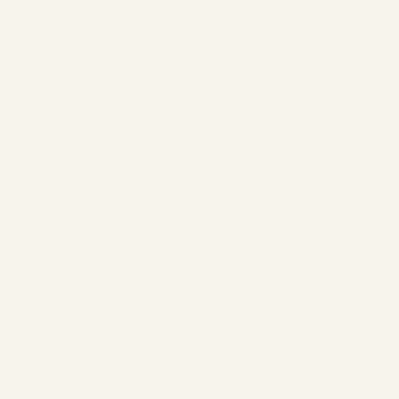

# Portable OpenType lettering

LumaStitch now offers the original digitized satin font plus Noto Sans, Noto Serif and Noto Sans Arabic outline fonts. Import an individual `.ttf` or `.otf` file from **Object → Add lettering**, choose font size, variable weight/width, language, text direction and tatami or automatic satin fill. The original font, its available license metadata and shaped outlines are embedded in the project, so reopening and editing text does not depend on fonts installed on another computer. Bundled fonts carry their complete SIL Open Font License.

Before this change, the lettering dialog supported only 118 digitized Geneva Simple Sans characters; Arabic and imported fonts were unavailable. These are feature examples, not a claim that outline fill replaces professionally digitized small-letter satin.

| Sans-serif | Serif |
| --- | --- |
|  |  |
| [Editable project](sans/sans.lumastitch) · [PES](sans/sans.pes) · [DST](sans/sans.dst) | [Editable project](serif/serif.lumastitch) · [PES](serif/serif.pes) · [DST](serif/serif.dst) |

| Arabic with marks | Arabic on a Bézier baseline |
| --- | --- |
|  |  |
| [Editable project](arabic/arabic.lumastitch) · [PES](arabic/arabic.pes) · [DST](arabic/arabic.dst) | [Editable project](arabic-curve/arabic-curve.lumastitch) · [PES](arabic-curve/arabic-curve.pes) · [DST](arabic-curve/arabic-curve.dst) |

Each folder also contains the SVG and a static PNG. The GIFs use the application's stitch renderer and show the actual exported plan. [Font editor screenshot](font-editor.png).

| Example | Font size (em mm) / weight | Needles | Trims | Jump distance |
| --- | --- | ---: | ---: | ---: |
| Luma | Noto Sans 30 / 700 | 1,419 | 4 | 54.77 mm |
| Stitch | Noto Serif 26 / 700 | 1,454 | 6 | 20.39 mm |
| سَلَام | Noto Sans Arabic 35 / 600 | 1,372 | 8 | 128.31 mm |
| سَلَام, curve | Noto Sans Arabic 35 / 600 | 1,454 | 8 | 94.76 mm |

HarfBuzz supplies kerning, ligatures, contextual forms and mark offsets. Glyph contours are combined into a nonzero fill per line, preserving holes and script joins. OpenType path/arc text bends the continuous outlines; digitized satin glyphs still use rigid tangent placement. Both support editable baseline guides, undo, full-block transforms and project persistence. Fill parameters remain editable in the usual inspector. Batch names are shaped independently and include complete project/PES pairs.

The independent `uharfbuzz 0.56.3` binding (HarfBuzz 14.6.0) matches every example's glyph IDs, clusters, advances and offsets. Tests reproduce all four committed PES files and compare every decoded needle coordinate with the rendered plan. Browser tests exercise the production WASM worker, bundled selection, file import, variable weight, batch names, undo/redo and editing after reload. These checks do not establish physical sew quality.

Current bounds: 10 MB per individual TTF/OTF; 1,000 text characters; 4,000 shaped glyphs; 5 MB of outline path data; 100 MB of embedded font data per batch. Collections, WOFF and bitmap/color-only fonts are rejected. OpenType font size is 5–100 mm per em, not cap height. Thin stems at small sizes can still be unsuitable for sewing. Three-initial monograms use the digitized font. Mixed-direction paragraphs are not implemented: use separate blocks for RTL text and Latin/numbers, and keep connected RTL letter spacing at zero. Font coverage determines supported scripts; the bundled Arabic example does not imply all fonts cover all languages.

Reproduce from the repository root:

```sh
EXAMPLES_MODULE=/tests/opentype/examples.ts node scripts/stitch-examples.mjs . docs/opentype
npm run build
node scripts/opentype-screenshot.mjs
python -m pip install uharfbuzz==0.56.3
python tests/tools/check_font_shaping.py
```

Fonts are unmodified files from [Google Fonts at bd8f81ddb5c74d5c8897b36ad88b440266245103](https://github.com/google/fonts/tree/bd8f81ddb5c74d5c8897b36ad88b440266245103/ofl); see [NOTICE](../../NOTICE.md) and the retained font licenses.
