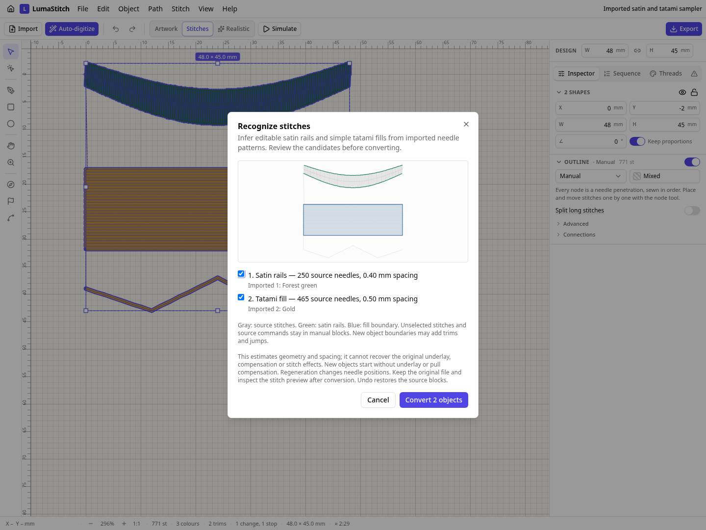

# Editable objects from machine stitches

Open a PES, DST, JEF, EXP or VP3 file, select its imported stitch blocks, then choose **Object → Recognize stitches…**. Review the inferred outlines, uncheck any candidate you want to leave manual, and convert. Satin candidates become two editable rails with direction guides; tatami candidates become editable fill boundaries. Their density and geometry can then regenerate stitches. One Undo restores the imported blocks.

The detector recognizes alternating satin penetrations and simple, regularly spaced serpentine tatami rows. It retains source controls, thread IDs, small entry/tie leftovers and unsupported stitches in manual blocks, in their original order. It never recognizes across a jump, trim or stop. New object boundaries can add trims and jumps. A recovered object's density is estimated from needle spacing; underlay and pull compensation start at none/zero because those original settings cannot be inferred reliably. Any retained original underlay remains manual.

This is **approximate recognition**, not recovery of the original digitizing file. The imported needle stream remains the default until you explicitly convert candidates. Keep the original file and inspect the regenerated preview. Unsupported cases include complex fill holes, mixed-direction fills, large sparse stitch effects, tight satin turns and split satin. The tool accepts up to 50,000 selected commands and 100 candidates. It does not recover text or font metadata, identify underlay, or infer fabric settings.

## Before, after and a real parameter edit

The source is a variable-width curved satin ribbon with center underlay, a tatami panel and a running flourish. It is exported to PES, decoded back to manual stitch blocks, and then recognized. The example retains an operator STOP and a thread change. After recognition, a third version increases both recovered objects' spacing by 40%; the original manual underlay and flourish stay at their original density.

| Actual engine output | Imported before | Recognized after | Spacing edited |
| --- | ---: | ---: | ---: |
| Needles | 771 | 769 | 574 |
| Trims | 2 | 3 | 3 |
| Jump distance | 22.50 mm | 22.55 mm | 22.55 mm |
| Color changes / operator stops | 1 / 1 | 1 / 1 | 1 / 1 |
| Thread length | 2,868.25 mm | 2,860.11 mm | 2,102.95 mm |

Recognition provides editability; these small stitch-count differences are not an optimization result. The one added trim is an object-boundary transition. Tatami needle phasing changes during regeneration; the tool does not claim to recover the source's phase pattern. The half-row extension of the inferred tatami boundary estimates its unsampled edge. Physical sew quality remains unverified.

| Imported before | Recognized after | Wider spacing |
| --- | --- | --- |
|  |  |  |

All GIFs use the real stitch engine and renderer, including retained manual underlay. Full files:

| Version | Editable project | Artwork | Machine outputs | Preview |
| --- | --- | --- | --- | --- |
| Imported before | [Project](before/before.lumastitch) | [SVG](before/before.svg) | [PES](before/before.pes), [DST](before/before.dst) | [PNG](before/preview.png) |
| Recognized after | [Project](after/after.lumastitch) | [SVG](after/after.svg) | [PES](after/after.pes), [DST](after/after.dst) | [PNG](after/preview.png) |
| Spacing edited | [Project](edited/edited.lumastitch) | [SVG](edited/edited.svg) | [PES](edited/edited.pes), [DST](edited/edited.dst) | [PNG](edited/preview.png) |



## Evidence and reproduction

Thirty independent synthetic machine files contain variable-width satin and tatami at six angles in all five supported formats. They are constructed and encoded by pyembroidery 1.5.1, without using the LumaStitch generator. Tests detect both objects with their known spacing. Additional tests cover reverse sewing direction, 0.1 mm coordinate quantization, residual needle/control preservation, STOP/color changes, invalid selection, work limits, parameter regeneration and project round trips. Browser tests exercise candidate review, selective conversion, undo and saved-project reload. These are synthetic fixtures, not an end-to-end quality comparison with proprietary recognition software.

```sh
/path/to/python-with-pyembroidery tests/tools/make_recognition_references.py
EXAMPLES_MODULE=/tests/recognition/examples.ts node scripts/stitch-examples.mjs . docs/recognition
npm run build
node scripts/recognition-screenshot.mjs
```

[Hatch documents a comparable object-recognition workflow](https://hatch.embroideryhelp.net/v4/en/OnlineHelp/Setup/assets/Machine_file_recognition.htm) that also retains unrecognized manual stitch blocks. This implementation is independently written and deliberately narrower; broad commercial-recognition parity is not established.
