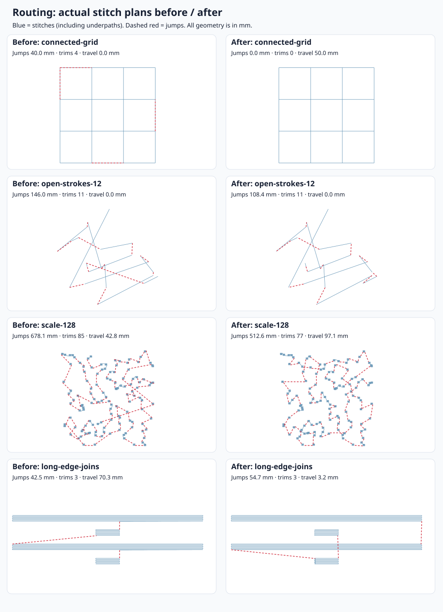

# Routing comparison

Baseline: LumaStitch `054c9470` (2026-10-10). After: this change. Measured with Node 26.10.0 on the same host, using identical synthetic geometry and parameters. All fixtures are original, deterministic test data.

The change adds exact small-route solvers, bounded search for larger routes, actual stitch-plan scoring, closest points along boundary segments, and optional intersection routing for running/bean outlines. It preserves overlap precedence, fixed-element relative order and manual stop boundaries. Tatami now prices the outgoing connector at its full length instead of discounting it to 0.3×.

## Before / after



Highlights from generated stitch plans:

- 128 islands: jump length **678.15 → 512.65 mm** (24.4% less), trims **85 → 77**.
- 12 open strokes: jump length **146.04 → 108.45 mm** (25.7% less), with the same 11 trims.
- Overlapping colour-unlocking fixture: colour changes **4 → 3**, trims **8 → 6**.
- Connected grid: internal jumps **40 → 0 mm**, trims **4 → 0**, with **50 mm** of added running underpaths when **Connect intersecting paths** is enabled.

[All 15 cases, including timings and tradeoffs](table.md). Machine-readable results: [before](before.json), [after](after.json). The diagram is rendered from actual `buildPlan` command segments, not a sketch of the optimization objective. Stats include the initial positioning jump; measured jump distance excludes it because there is no previous command position.

Tradeoffs remain explicit. On the long-edge fixture, jump length rises from **42.46 to 54.66 mm**, while internal travel falls from **70.31 to 3.22 mm**, with the same three trims. More search also costs CPU: the 128-island case takes about **76 ms** versus **13 ms**. The selection objective is actual colour changes first, then `3 × jump mm + travel mm + 10 × trims`, not a guarantee that every metric improves. The coefficients reflect the existing fill router's preference for sewn travel over jumps; they are not calibrated machine times.

Each timing is the median of three warm-up-following runs of `optimizeSequence` plus a fresh `buildPlan`. The optimizer shares prepared geometry internally while comparing candidate plans; benchmark runs do not share a cache. Timings are local observations, not CI performance assertions. The normal correctness suite also checks the existing 50k-stitch generation budget.

## Complete satin and tatami examples

[The example gallery](../stitch-examples/README.md) includes animated before/after GIFs, PNGs, editable projects, source SVG artwork and PES/DST files. Satin routing uses actual needle endpoints, accounting for all underlay passes. For small designs the sequence optimizer additionally evaluates adjacent colour-block and same-colour neighbour swaps against full stitch plans (two rounds, at most eight extra evaluations each).

- Satin botanical: **116.32 → 79.58 mm** jump length and **13 → 6** trims.
- Tatami compass: **304.20 → 288.44 mm** jumps and **227.72 → 215.84 mm** internal travel, with the same 13 trims.
- The complete tatami example takes about **204 ms** versus **39 ms** on this host; this is a deliberate quality/latency tradeoff.

## Ink/Stitch reference

Ink/Stitch documents [intersection-aware running auto-routing and underpaths](https://inkstitch.org/docs/stroke-tools/), and [its routing guide](https://inkstitch.org/tutorials/routing/) emphasizes avoiding jumps and unnecessary colour changes. Wilcom documents [closest joins](https://docs.wilcom.com/embroiderystudio/27/en/OnlineHelp/Summary/summary_-_edit/summary_-_edit-66.htm) between closed objects.

For a reproducible algorithm comparison, we execute Ink/Stitch's **unmodified** `find_path` and `_get_shortest_path` functions from [`lib/stitches/utils/autoroute.py` at d59c9ab1](https://github.com/inkstitch/inkstitch/blob/d59c9ab1e390285a6c67822436ffd9ba9843d8b4/lib/stitches/utils/autoroute.py), using NetworkX 3.5. Both implementations receive the same connected graph, insertion order and start/end vertices. Assertions verify that the upstream result is continuous, reaches the specified endpoints and covers every required edge.

| Identical graph                     | Required line length | Ink/Stitch added traversal | LumaStitch added traversal | Internal jumps, both |
| ----------------------------------- | -------------------: | -------------------------: | -------------------------: | -------------------: |
| T junction                          |                30 mm |                      10 mm |                      10 mm |                    0 |
| Square cycle, same start/end        |               120 mm |                     120 mm |                       0 mm |                    0 |
| 4×4 grid, opposite-corner start/end |               240 mm |                     180 mm |                      60 mm |                    0 |

[Raw reference results](inkstitch.json). LumaStitch matches or improves these graph-traversal results. Its minimum-cost parity matching avoids unnecessary retracing of cycles; matching is exact up to 16 parity defects. An independent exhaustive all-edges shortest-walk oracle tests this on small graphs.

**Scope:** this is a graph-algorithm comparison, not an end-to-end Ink/Stitch export comparison. Ink/Stitch's SVG processing, running-stitch sampling, Redwork extension, satin autorouter and fill router are not exercised. The fixture corpus does not establish universal state-of-the-art parity, and proprietary Wilcom/PE-Design output and physical sew quality have not been compared. The grid in the before/after panel uses automatic endpoints; the reference table fixes opposite-corner endpoints, hence the different added-travel totals.

## Using intersection routing

Select a compound running or triple-run outline, open **Advanced**, and enable **Connect intersecting paths**. It is off by default, because adding underpaths changes thread density. It applies to one-pass outlines; the final traversal keeps the requested bean repeats, and added traversals are single running stitches. Original overlapping lines remain separate required edges. It routes within one element, so it never crosses another element's stops or thread changes. Large networks fall back with a diagnostic; multiple passes retain their existing whole-path semantics.

## Reproduce

Install the repository's locked dependencies first (`npm ci`). Use Jujutsu for this colocated repository. From the PR workspace:

```bash
jj workspace add /tmp/lumastitch-routing-before -r 054c9470
ln -s "$PWD/node_modules" /tmp/lumastitch-routing-before/node_modules
cp -r tests/routing /tmp/lumastitch-routing-before/tests/routing
node scripts/benchmark-routing.mjs /tmp/lumastitch-routing-before /tmp/routing-before.json --paths
node scripts/benchmark-routing.mjs . /tmp/routing-after.json --paths
node scripts/render-routing-comparison.mjs /tmp/routing-before.json /tmp/routing-after.json docs/routing
```

Run the pinned reference comparison separately (network access is only needed for these development dependencies; the app remains offline):

```bash
python3 -m venv /tmp/lumastitch-routing-python
/tmp/lumastitch-routing-python/bin/pip install networkx==3.5
curl -fL https://raw.githubusercontent.com/inkstitch/inkstitch/d59c9ab1e390285a6c67822436ffd9ba9843d8b4/lib/stitches/utils/autoroute.py -o /tmp/inkstitch-autoroute.py
node scripts/benchmark-network.mjs /tmp/lumastitch-network-cases.json
/tmp/lumastitch-routing-python/bin/python tests/tools/compare_inkstitch_routing.py /tmp/inkstitch-autoroute.py /tmp/lumastitch-network-cases.json docs/routing/inkstitch.json
```

The script verifies the upstream file's SHA-256 before extracting only the two routing functions. No upstream Python source or NetworkX dependency is bundled in the app. Forget the temporary Jujutsu workspace when finished with it.

## Validation

- Exhaustive permutation oracles for small precedence/colour routes and joint open-stroke order/direction, including even-pass endpoints. Satin additionally checks actual needle endpoints for all seven underlay combinations.
- Independent shortest-walk oracle for small connected networks; crossings, T junctions, collinear overlap, parallel edges, disconnected components, bean underpaths, geometry limits and large matching fallback.
- Stop boundaries, contradictory fixed order, unselected-element order, closest edge-interior joins, multipart exit constraints, and actual-plan scoring for wide fills.
- Full checks passed: TypeScript, ESLint, Prettier, **563 unit/browser tests** (four existing optional tests skipped), production build and **17 Playwright tests**, including inspector toggle → worker regeneration → undo.
- Complete satin/tatami example projects round-trip through PES v6 with every needle penetration preserved. Before/after GIFs each contain 121 frames over 10.08 seconds, generated by the app renderer and inspected at intermediate and final frames.
- README screenshots and stitch-out animation regenerated from the production build.
