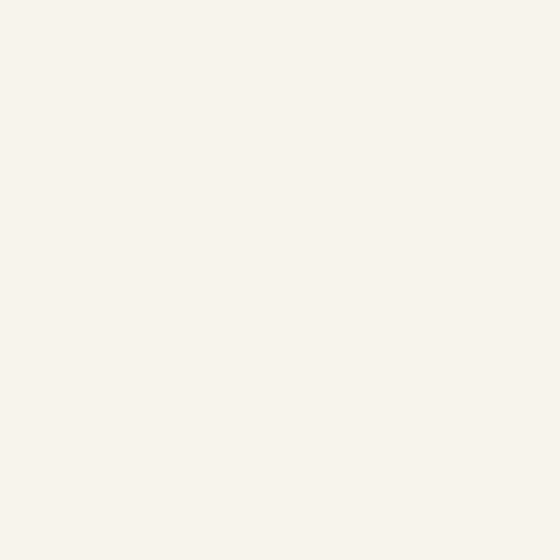

# Editable satin splitting

Open [the original ribbon](before/before.lumastitch), select it and choose **Object → Split satin column**. Set **Position along column** to **45%**. The red preview line marks the shared rail endpoints; **Split column** replaces the original with two editable Satin rails objects in one undo step.

[Split project](after/after.lumastitch) · [Dialog screenshot](dialog.png) · [Metrics](metrics.json)

| Original column | Two editable sections |
| --- | --- |
|  |  |

Each folder includes a project, SVG, PES, DST, PNG and GIF. The example has variable-width Bézier rails and an angled direction rung. The split preserves paired rail positions and direction correspondence, snapshots the effective stitch settings, and applies pull compensation once during regeneration. Centerline satin is also supported and becomes explicit rail geometry. Curve geometry is flattened at 0.03 mm; rail sampling and editable direction guides replace the original Bézier handles. Entry/exit hints are cleared.

This is a manual digitizing operation, not a route improvement: independent sections allow different densities, threads, underlay or sequence positions, but can add locks/jumps/trims. This example changes from 816 needles / no trims to 828 needles / one trim, with a 7.09 mm jump across the cut. Use undo to restore the original, or edit the two sections individually. Splitting a lettering column detaches that lettering block's text metadata.

Select one open satin outline or explicit rail column without a fill. Closed columns and compound centerlines must first be opened/broken apart. Work is bounded to 2,000 column samples; each section must be at least 0.1 mm long. Tests compare paired rail geometry before/after, compensation, underlay, project persistence and browser undo/redo. Rendered GIFs show generated needle paths; physical seam quality remains unverified.

```sh
EXAMPLES_MODULE=/tests/satin-split/examples.ts node scripts/stitch-examples.mjs . docs/satin-split
node scripts/satin-split-screenshot.mjs
```
