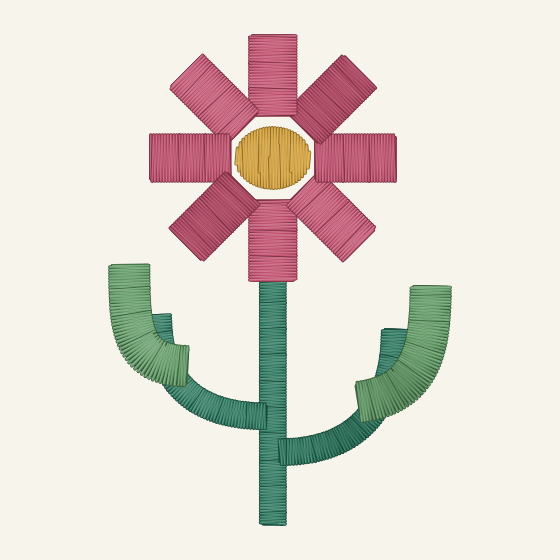
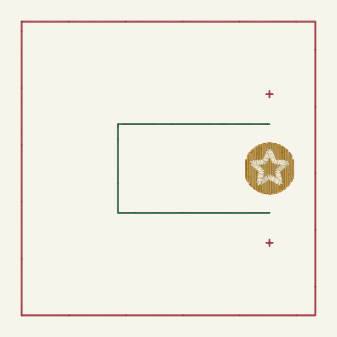
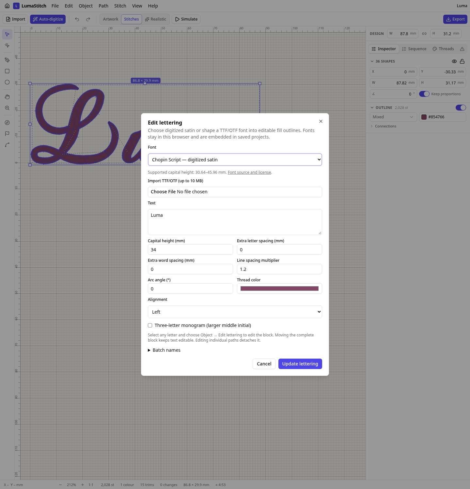
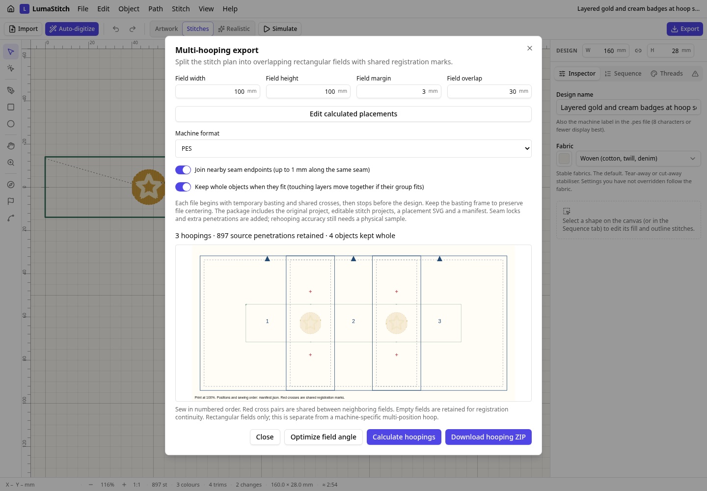

# Example screenshots and videos

These screenshots and accelerated stitch-out animations come from LumaStitch's actual generated stitch plans. They are software simulations, not footage of physical sewing. The MP4s show the baseline on the left and the improved router on the right, with the same geometry and stitch settings. Each side completes in eight seconds, followed by a two-second hold; playback duration does not measure sewing speed.

## Satin botanical

| Before | After |
| --- | --- |
|  |  |
| 13 trims · 116.32 mm jumps | **6 trims · 79.58 mm jumps** |

[Watch/download the before-and-after MP4](satin-botanical.mp4?raw=true) · [Animated GIFs, editable projects and PES/DST files](../stitch-examples/README.md#satin-botanical)

## Tatami compass

| Before | After |
| --- | --- |
|  |  |
| 304.20 mm jumps · 227.72 mm travel | **288.44 mm jumps · 215.84 mm travel** |

[Watch/download the before-and-after MP4](tatami-compass.mp4?raw=true) · [Animated GIFs, editable projects and PES/DST files](../stitch-examples/README.md#tatami-compass)

## More rendered examples and application screenshots

| Script lettering | Whole layers across hoop seams |
| --- | --- |
|  |  |
| [Three fonts, GIFs and complete projects](../digitized-fonts/README.md) | [Before/after GIFs and machine packages](../hooping-layers/README.md) |





Other galleries: [guided fills](../guided-fill/README.md), [appliqué](../applique/README.md), [connected satin rails](../satin-rails/README.md), [stitch recognition](../recognition/README.md), [mixed-direction lettering](../bidi/README.md), [density inspection](../inspection/README.md), and [rotated multi-hooping](../hooping-placements/README.md). Each includes rendered GIF playback and downloadable examples.

The lettering images use licensed digitized fonts; attribution and source notices are in the [font gallery](../digitized-fonts/README.md#source-and-reproduction) and [NOTICE.md](../../NOTICE.md).

## Reproduce the videos

With FFmpeg installed (including libx264 and drawtext), run from the repository root:

```sh
node scripts/example-videos.mjs
```

This combines the checked-in renderer GIFs into 1120 × 608 H.264 MP4s with before/after labels, 24 fps, and fast-start playback. The input GIFs have approximately 12 unique frames per second; encoding at 24 fps preserves their timing without adding simulated stitch detail. See the [example generation instructions](../stitch-examples/README.md#reproduce) to regenerate the original plans and frames.
